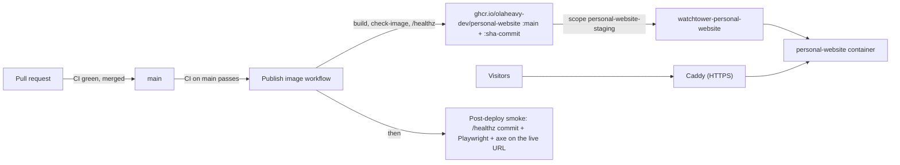

# Deploying olaheavy.dev

The site runs as one Docker container on the owner's SoloForge VPS (decision 0003). This page covers what this repository does; server-side steps live in the private infra repository (Phase 19, Personal Website Deployment).

## How a change reaches the site



1. CI passes on `main` (`make check`, e2e and accessibility, dependency review, workflow lint).
2. **Publish image** first checks the Supabase build values are present (see Environment below), builds the image with the commit and those values baked in, refuses it if `scripts/check-image.sh` finds private files or a root user, runs the candidate image with no Supabase variables and checks that `/healthz` reports the commit and `"supabase":"configured"` (which proves the values were written into the build), then pushes `:sha-<commit>` and `:main`. It refuses to publish if `main` has moved on since CI checked it.
3. Watchtower on the VPS pulls the new `:main` and recreates only the `personal-website` container.
4. **Post-deploy smoke** waits up to 15 minutes for `/healthz` to report the new commit, checks it reports `"supabase":"configured"`, checks staging is hidden from search engines, then runs the Playwright journeys and axe against the live URL.

## Where it runs

| Item           | Value                                                                                   |
| -------------- | --------------------------------------------------------------------------------------- |
| Staging URL    | `https://staging.olaheavy.dev` (hidden from search engines by Caddy)                    |
| Production URL | `https://olaheavy.dev` (later: one Caddy and DNS change promotes the same image)        |
| Health         | `/healthz` returns `{"status":"ok","sha":"<commit>","supabase":"configured"}`           |
| Image          | `ghcr.io/olaheavy-dev/personal-website` (public)                                        |
| Container      | `personal-website`, on `caddy_net`, no host ports, all capabilities dropped, non-root   |
| Compose file   | `deploy/docker-compose.prod.yml` (owned here, copied to the server by the infra helper) |
| Watchtower     | instance `watchtower-personal-website`, scope `personal-website-staging`                |

## First deploy (owner, once)

GitHub creates a new package as private, and Watchtower can't pull a private image without credentials, so the first rollout needs three manual steps:

1. **DNS:** in Cloudflare, add an `A` record `staging` pointing at the retained VPS IPv4, **DNS only**, TTL Auto (the same as `foresight`).
2. **Make the image public:** after the first **Publish image** run on `main`, open the `personal-website` package in GitHub's package settings and set its visibility to public.
3. **Start it on the server:** over WireGuard, run the infra repository's `deploy-personal-website.sh` (dry run first, then apply) and deploy `watchtower-personal-website` with scope `personal-website-staging`. The steps are in the infra wiki page Personal Website Deployment.

After that, every merge to `main` rolls out on its own.

## Security headers

The app is the only source of the site's security headers (decision 0017). They are set in `next.config.ts` from `src/lib/security/headers.ts`: a Content Security Policy per kind of path, HSTS (`max-age=31536000`, no `includeSubDomains`, no `preload`), `X-Content-Type-Options`, `Referrer-Policy`, `Permissions-Policy`, `Cross-Origin-Opener-Policy` and `X-Frame-Options`.

- **Caddy must stop setting three of them first.** Today Caddy's `header` block in the infra repository's `scripts/deploy-personal-website.sh` sets `X-Content-Type-Options`, `Referrer-Policy` and HSTS. That block runs first, and `reverse_proxy` then adds the app's headers, so once the app sends them each appears twice. Remove those three lines (keep `X-Robots-Tag` on staging) before or together with the deploy of this change, or every response carries duplicates and the post-deploy smoke fails. When `/admin` is wired, Caddy's staging `X-Robots-Tag` will also duplicate the one the admin headers set, so decide then which side keeps it.
- **`/_next/image`** responses carry Next's own, stricter policy (`script-src 'none'; frame-src 'none'; sandbox`) instead of ours. That is expected.
- **Trailing slash redirects** (for example `/work/` to `/work`) are answered before the headers rules run, so those 308 responses carry no security headers. They have no body, which is accepted (decision 0017).
- **Cloudflare:** Email Obfuscation, Rocket Loader and Web Analytics must stay off. Each injects script or loads from another origin, and the policy would block it.
- **Cloudflare must not cache HTML for more than 60 seconds** (#54). A flag change refreshes the site's own pages at once, but an edge copy would keep showing the old page, and a hidden page's 404, until it expires (decision 0018).
- **`/api/revalidate` counts wrong guesses per address from `X-Forwarded-For`**, and ignores `cf-connecting-ip`: staging is not behind Cloudflare (its DNS record is not proxied), so that header is always supplied by the caller. Without `trusted_proxies`, Caddy replaces a client's `X-Forwarded-For` with the connecting address, so the app reads its one entry. When #54 turns on the Cloudflare proxy: set Caddy `trusted_proxies` to Cloudflare's ranges, restrict the origin to Cloudflare, and only then switch the app to `cf-connecting-ip`. The secret is the real protection either way: a right secret is never limited, and a wrong one is never accepted.
- **The smoke test checks them live.** `e2e/security.spec.ts` runs against staging in the post-deploy smoke: exact policy per path, every base header present, and no header repeated.
- **Checking by hand:** `curl -sI https://staging.olaheavy.dev/` and look for one `Content-Security-Policy`, or scan the URL at securityheaders.com (target grade A).
- **Adding a third party** (analytics, an embed, a font host): add its origin to `buildCsp` in `headers.ts` with a test, never `*`.

## Expected red runs

- **Publish image: "main moved on".** When two merges land close together, the older commit's publish run fails on purpose, because `main` no longer points at it. The newer commit's run publishes, so nothing is lost.
- **Post-deploy smoke: notice, not failure.** If a newer commit reaches the site before an older commit's smoke sees its own, that smoke stops with a notice and the newer commit's smoke does the testing.

## Build and check the image locally

```bash
make docker-build      # personal-website:local, with the current commit baked in
make docker-check      # refuses private files and a root user
docker run --rm -p 127.0.0.1:3000:3000 --cap-drop ALL personal-website:local
curl -s http://127.0.0.1:3000/healthz
```

`make docker-build` passes `NEXT_PUBLIC_SUPABASE_URL` and `NEXT_PUBLIC_SUPABASE_PUBLISHABLE_KEY` from your shell when both are set. Otherwise it builds with `SUPABASE_OPTIONAL=1`, a local smoke image with Supabase unconfigured. Never publish that image: every gated page is baked Off, so the site is all 404s.

## Roll back

Every published commit keeps its `:sha-<commit>` tag. To roll back, pin the Compose image to a known good `:sha-<commit>` on the server and run `docker compose up -d`, then fix forward on `main` and return the image to `:main`.

## Environment

### Build values (public)

`NEXT_PUBLIC_*` values are written into the build by Next.js, so the running container never reads them. They arrive like this:

1. The owner stores `NEXT_PUBLIC_SUPABASE_URL` and `NEXT_PUBLIC_SUPABASE_PUBLISHABLE_KEY` as GitHub Actions **variables** (Settings, Secrets and variables, Actions, Variables). They are public by design.
2. `publish.yml` first runs `scripts/check-build-env.mjs`, then passes both as `build-args` to the Docker build.
3. The Dockerfile's build stage reads them as build arguments, runs the same check, and `next build` inlines them. The runtime stage never sees them.

**The publish build fails without them.** The check refuses a missing URL, a URL that is not `https://<20 lowercase letters>.supabase.co`, and a key that does not start with `sb_publishable_`. Its message names the variable, never the value. Pull request builds in `ci.yml` do not use the hosted project: `make build` reads the flags from the fake Supabase server in `e2e/fixtures/` (its address is written into that build only). Only a local smoke build may skip the check, with `SUPABASE_OPTIONAL=1`.

**Flags are read at build time too.** `next build` reads `feature_flags` while it prerenders, so an image built with a wrong key or an unreachable project fails the build instead of baking in a site where every page is Off. `/healthz` shows `"supabase":"configured"` when the values are in the build; it is read at request time and never shows a value.

`src/lib/db/env.ts` must keep reading these with the full literal name (`process.env.NEXT_PUBLIC_SUPABASE_URL`), because Next only inlines literal names. `NEXT_PUBLIC_CONTACT_EMAIL` is also a build value, but the Dockerfile and `publish.yml` do not pass it, so images use the fallback in `site.ts` unless it is passed the same way.

`scripts/env-inlining.test.ts` builds a small app with dummy values, starts it without them and checks they are still read.

`keep-alive.yml` reads one public row from `feature_flags` every day (06:17 UTC) with the publishable key, so the hosted project is never paused for inactivity. It fails if the row is missing, and can be run by hand from the Actions tab. GitHub disables scheduled workflows on a public repository after 60 days without activity (and only the default branch's schedule runs); it emails a warning, and the owner re-enables the workflow from the Actions tab or runs it by hand.

### Runtime secrets (server only)

`REVALIDATE_SECRET` is the first runtime secret. It guards `POST /api/revalidate`, which the Supabase Database Webhook calls when a feature flag changes (setup steps in `docs/database.md`). Until it is set the route answers 503 and flag changes reach the pages only through the one hour backstop. Make it with `openssl rand -hex 32`.

When Supabase's secret key, Hashnode and the assistant arrive, their server-only keys go in `/home/apps/personal-website/.env` (mode 600) through the infra helper, never in this repository or the image.
