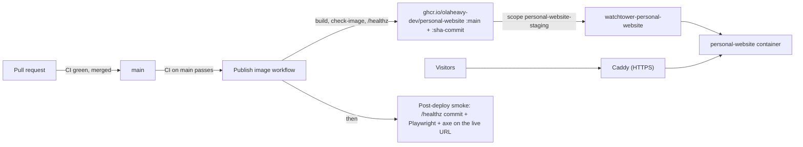

# Deploying olaheavy.dev

The site runs as one Docker container on the owner's SoloForge VPS (decision 0003). This page covers what this repository does; server-side steps live in the private infra repository (Phase 19, Personal Website Deployment).

## How a change reaches the site



1. CI passes on `main` (`make check`, e2e and accessibility, dependency review, workflow lint).
2. **Publish image** builds the image with the commit baked in, refuses it if `scripts/check-image.sh` finds private files or a root user, checks that `/healthz` reports the commit, then pushes `:sha-<commit>` and `:main`. It refuses to publish if `main` has moved on since CI checked it.
3. Watchtower on the VPS pulls the new `:main` and recreates only the `personal-website` container.
4. **Post-deploy smoke** waits up to 15 minutes for `/healthz` to report the new commit, checks staging is hidden from search engines, then runs the Playwright journeys and axe against the live URL.

## Where it runs

| Item           | Value                                                                                   |
| -------------- | --------------------------------------------------------------------------------------- |
| Staging URL    | `https://staging.olaheavy.dev` (hidden from search engines by Caddy)                    |
| Production URL | `https://olaheavy.dev` (later: one Caddy and DNS change promotes the same image)        |
| Health         | `/healthz` returns `{"status":"ok","sha":"<commit>"}`                                   |
| Image          | `ghcr.io/olaheavy-dev/personal-website` (public)                                        |
| Container      | `personal-website`, on `caddy_net`, no host ports, all capabilities dropped, non-root   |
| Compose file   | `deploy/docker-compose.prod.yml` (owned here, copied to the server by the infra helper) |
| Watchtower     | instance `watchtower-personal-website`, scope `personal-website-staging`                |

## Build and check the image locally

```bash
make docker-build      # personal-website:local, with the current commit baked in
make docker-check      # refuses private files and a root user
docker run --rm -p 127.0.0.1:3000:3000 --cap-drop ALL personal-website:local
curl -s http://127.0.0.1:3000/healthz
```

## Roll back

Every published commit keeps its `:sha-<commit>` tag. To roll back, pin the Compose image to a known good `:sha-<commit>` on the server and run `docker compose up -d`, then fix forward on `main` and return the image to `:main`.

## Environment

The site needs no runtime secrets yet. `NEXT_PUBLIC_*` values are build time, so they come from the build, not the server. When Supabase, Hashnode and the assistant arrive, their server-only keys go in `/home/apps/personal-website/.env` (mode 600) through the infra helper, never in this repository or the image.
