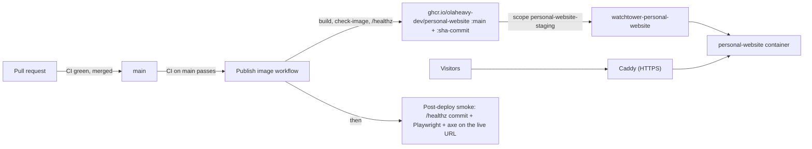

# Deploying olaheavy.dev

The site runs as one Docker container on the owner's SoloForge VPS (decision 0003). This page covers what this repository does; server-side steps live in the private infra repository (Phase 19, Personal Website Deployment).

## How a change reaches the site



1. CI passes on `main` (`make check`, e2e and accessibility, dependency review, workflow lint).
2. **Publish image** builds the image with the commit baked in, refuses it if `scripts/check-image.sh` finds private files or a root user, checks that `/healthz` reports the commit, then pushes `:sha-<commit>` and `:main`. It refuses to publish if `main` has moved on since CI checked it.
3. Watchtower on the VPS pulls the new `:main` and recreates only the `personal-website` container.
4. **Post-deploy smoke** waits up to 15 minutes for `/healthz` to report the new commit, checks staging is hidden from search engines, then runs the Playwright journeys and axe against the live URL.

## Where it runs

| Item           | Value                                                                                   |
| -------------- | --------------------------------------------------------------------------------------- |
| Staging URL    | `https://staging.olaheavy.dev` (hidden from search engines by Caddy)                    |
| Production URL | `https://olaheavy.dev` (later: one Caddy and DNS change promotes the same image)        |
| Health         | `/healthz` returns `{"status":"ok","sha":"<commit>"}`                                   |
| Image          | `ghcr.io/olaheavy-dev/personal-website` (public)                                        |
| Container      | `personal-website`, on `caddy_net`, no host ports, all capabilities dropped, non-root   |
| Compose file   | `deploy/docker-compose.prod.yml` (owned here, copied to the server by the infra helper) |
| Watchtower     | instance `watchtower-personal-website`, scope `personal-website-staging`                |

## First deploy (owner, once)

GitHub creates a new package as private, and Watchtower can't pull a private image without credentials, so the first rollout needs three manual steps:

1. **DNS:** in Cloudflare, add an `A` record `staging` pointing at the retained VPS IPv4, **DNS only**, TTL Auto (the same as `foresight`).
2. **Make the image public:** after the first **Publish image** run on `main`, open the `personal-website` package in GitHub's package settings and set its visibility to public.
3. **Start it on the server:** over WireGuard, run the infra repository's `deploy-personal-website.sh` (dry run first, then apply) and deploy `watchtower-personal-website` with scope `personal-website-staging`. The steps are in the infra wiki page Personal Website Deployment.

After that, every merge to `main` rolls out on its own.

## Security headers

The app is the only source of the site's security headers (decision 0017). They are set in `next.config.ts` from `src/lib/security/headers.ts`: a Content Security Policy per kind of path, HSTS (`max-age=31536000`, no `includeSubDomains`, no `preload`), `X-Content-Type-Options`, `Referrer-Policy`, `Permissions-Policy`, `Cross-Origin-Opener-Policy` and `X-Frame-Options`.

- **Caddy today** also sets `X-Content-Type-Options`, `Referrer-Policy` and HSTS, with the same values, in the infra repository's `scripts/deploy-personal-website.sh`. Caddy's `header` directive replaces a header rather than adding a second one, so nothing is duplicated. An owner merged infra change will remove those three lines and keep `X-Robots-Tag` on staging, so the app stays the single source.
- **Cloudflare:** Email Obfuscation, Rocket Loader and Web Analytics must stay off. Each injects script or loads from another origin, and the policy would block it.
- **The smoke test checks them live.** `e2e/security.spec.ts` runs against staging in the post-deploy smoke: exact policy per path, every base header present, and no header repeated.
- **Checking by hand:** `curl -sI https://staging.olaheavy.dev/` and look for one `Content-Security-Policy`, or scan the URL at securityheaders.com (target grade A).
- **Adding a third party** (analytics, an embed, a font host): add its origin to `buildCsp` in `headers.ts` with a test, never `*`.

## Expected red runs

- **Publish image: "main moved on".** When two merges land close together, the older commit's publish run fails on purpose, because `main` no longer points at it. The newer commit's run publishes, so nothing is lost.
- **Post-deploy smoke: notice, not failure.** If a newer commit reaches the site before an older commit's smoke sees its own, that smoke stops with a notice and the newer commit's smoke does the testing.

## Build and check the image locally

```bash
make docker-build      # personal-website:local, with the current commit baked in
make docker-check      # refuses private files and a root user
docker run --rm -p 127.0.0.1:3000:3000 --cap-drop ALL personal-website:local
curl -s http://127.0.0.1:3000/healthz
```

## Roll back

Every published commit keeps its `:sha-<commit>` tag. To roll back, pin the Compose image to a known good `:sha-<commit>` on the server and run `docker compose up -d`, then fix forward on `main` and return the image to `:main`.

## Environment

The site needs no runtime secrets yet. `NEXT_PUBLIC_*` values are build time, so they come from the build, not the server. When Supabase, Hashnode and the assistant arrive, their server-only keys go in `/home/apps/personal-website/.env` (mode 600) through the infra helper, never in this repository or the image.
